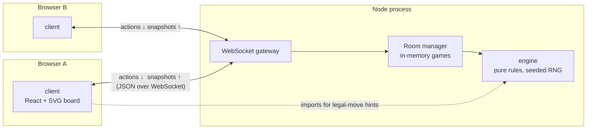
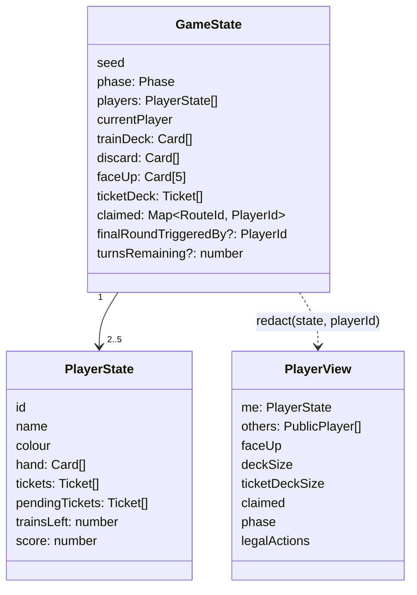
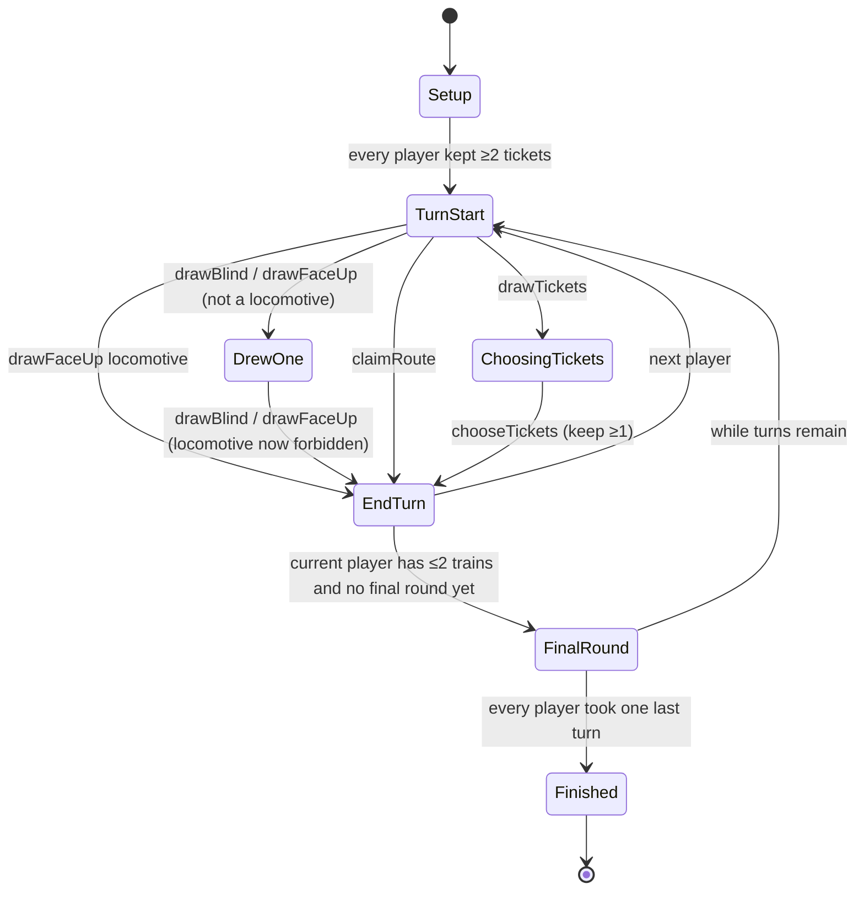
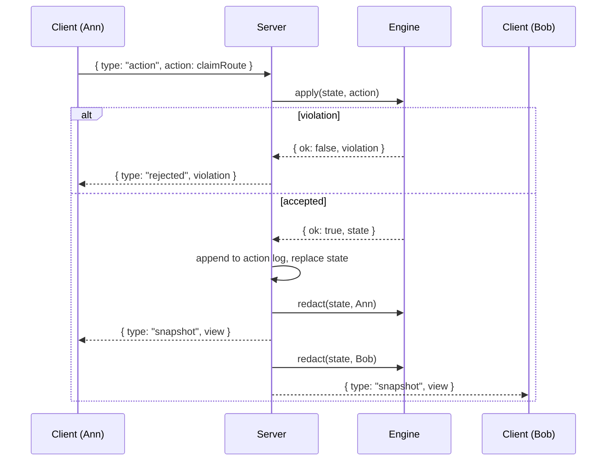

# Railyard architecture

How the online Ticket to Ride clone is put together. Decisions here were settled in the design interview on 2026-10-23; vocabulary follows `GLOSSARY.md`.

## 1. The big picture

Three packages in one pnpm workspace. The engine knows the rules and nothing else. The server owns games and talks to browsers. The client draws what the server sends and turns clicks into actions.



Rules live in exactly one place. The client imports the same engine package only to grey out illegal moves before the server rejects them. The server's answer is always the one that counts.

## 2. Repository layout

```
railyard/
├── GLOSSARY.md
├── docs/
│   ├── architecture.md        ← this file
│   ├── adr/
│   └── agents/
├── packages/
│   ├── engine/                 pure TypeScript, no I/O, no timers
│   │   └── src/
│   │       ├── data/usa.ts     36 cities, 100 routes, 30 tickets
│   │       ├── state.ts        GameState, PlayerState, Phase
│   │       ├── actions.ts      Action union + RuleViolation
│   │       ├── apply.ts        apply(state, action) → state | violation
│   │       ├── legal.ts        legalActions(state, playerId)
│   │       ├── setup.ts        createGame(players, seed)
│   │       ├── rng.ts          seeded generator + shuffle
│   │       ├── scoring/
│   │       │   ├── routes.ts   1,2,4,7,10,15
│   │       │   ├── tickets.ts  connectivity per player
│   │       │   └── longestPath.ts
│   │       └── view.ts         redact(state, playerId) → PlayerView
│   ├── server/                 Node, ws, serves the built client
│   │   └── src/
│   │       ├── index.ts        HTTP + WebSocket bootstrap
│   │       ├── rooms.ts        create/join/reconnect, lobby → playing → finished
│   │       ├── protocol.ts     message types shared with client
│   │       └── session.ts      reconnect tokens
│   └── client/                 React + Vite
│       └── src/
│           ├── screens/        Home, Lobby, Game, Summary
│           ├── board/          Board.tsx (SVG), layout from city coordinates
│           ├── panels/         Hand, FaceUpCards, Tickets, Players, ActionBar
│           ├── ws.ts           socket client, snapshot store
│           └── theme.ts
├── package.json                pnpm workspace
└── pnpm-workspace.yaml
```

Dependency direction is strict: `client → engine`, `server → engine`, and `engine → nothing`.

## 3. The engine

One function does all the work:

```ts
apply(state: GameState, action: Action): { ok: true; state: GameState } | { ok: false; violation: RuleViolation }
```

It never mutates its input and never touches the clock or `Math.random`. Shuffles come from a generator seeded at game creation, so replaying the action log from the seed rebuilds the identical game.

### 3.1 State



`PublicPlayer` carries only what a table shows: name, colour, score, trains left, hand size, ticket count.

### 3.2 Actions

| Action                          | Who            | When                                 |
| ------------------------------- | -------------- | ------------------------------------ |
| `chooseInitialTickets { keep }` | each player    | setup, keep at least 2 of 3          |
| `drawFaceUp { index }`          | current player | turn start, or second draw           |
| `drawBlind`                     | current player | turn start, or second draw           |
| `claimRoute { routeId, cards }` | current player | turn start                           |
| `drawTickets`                   | current player | turn start                           |
| `chooseTickets { keep }`        | current player | after `drawTickets`, keep at least 1 |

### 3.3 Turn state machine



Invariants checked on every transition, each one a unit test:

- Three locomotives face up at any moment: discard all five, deal five new.
- Deck empty: reshuffle discards. Deck and discards both empty: draw actions are not legal.
- Claiming: card set is one colour plus locomotives, count equals route length, colour matches unless the route is grey, route is unclaimed, player has enough trains. In 2 and 3 player games the twin of a claimed double route becomes unclaimable; in any game a player cannot hold both twins.
- Tickets drawn: up to 3, fewer if the deck is short; returned tickets go to the bottom.

### 3.4 Scoring

- Routes score as they are claimed: 1, 2, 4, 7, 10, 15.
- At `Finished`: for each player, build the graph of their claimed routes, check each ticket's two cities for connectivity, add or subtract.
- Longest path: depth-first search over each player's claimed routes, no route reused, cities may repeat. Everyone tied for the maximum gets 10.
- Ranking: points, then completed tickets, then longest-path holder.

## 4. The server



Rooms:

- `createGame` returns a six-character join code. The room starts in the lobby.
- `join { code, name, colour }` adds a player and returns a reconnect token the browser stores locally.
- `start` from the host shuffles turn order, picks a random first player, and calls `createGame(players, seed)`.
- A socket that reconnects with its token is reattached to its player and receives a fresh snapshot. No timers, no kicks.
- `rematch` from the host at `Finished` creates a new game with the same players and a new seed.

Everything is in memory. A restart loses all rooms; this is accepted for v1.

## 5. The client

Screens follow the room lifecycle: **Home** (create or join) → **Lobby** (names, colours, start button) → **Game** → **Summary** (revealed tickets, score breakdown, rematch).

The Game screen is one SVG board plus panels:

- **Board**: cities at the dataset coordinates, routes as dashed lines with one dash per space, coloured by route colour, filled with the owner's colour once claimed. Clicking an unclaimed route opens the claim dialog with card choices.
- **Face-up cards** and the **deck** are clickable when drawing is legal.
- **Hand** groups cards by colour with counts.
- **Tickets** shows kept tickets with live completed-or-not status, computed with the engine's connectivity check on the player's own view.
- **Players** sidebar shows public info and whose turn it is.

The client holds no rule logic of its own. It calls `legalActions(view)` from the engine to enable and disable controls, and sends the action. Whatever the server returns is rendered.

## 6. Testing strategy

- **Engine**: Vitest unit tests per rule, written test-first. Property test: replaying any action log from its seed yields an identical final state.
- **Server**: integration tests driving two WebSocket clients through a short game.
- **Client**: component tests for the board hit-testing and the claim dialog; the rest is covered by playing.

## 7. Out of scope for v1

Spectators, chat, sound, turn timers, kicking, bots, accounts, persistence, other maps. None of these change the engine's interface.
